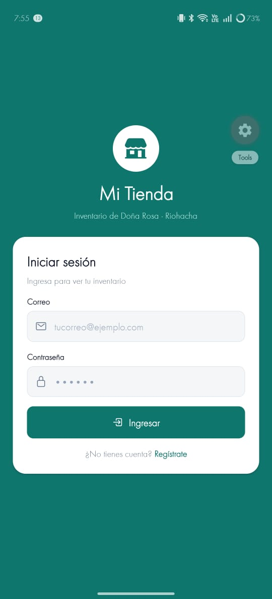
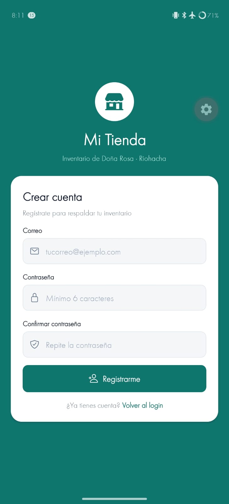
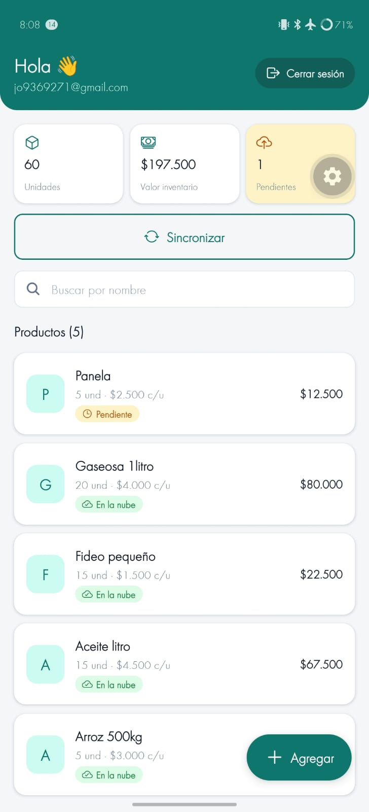
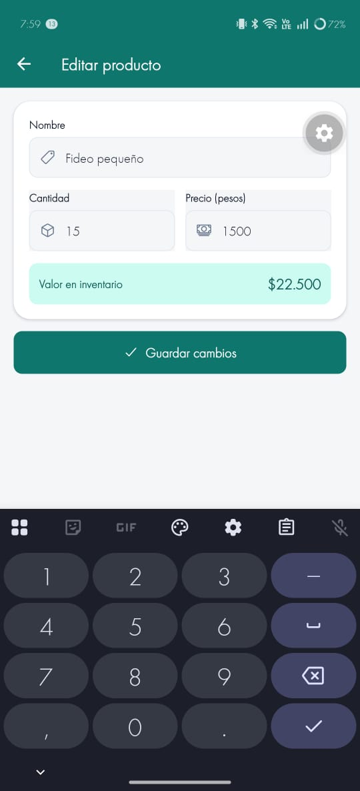
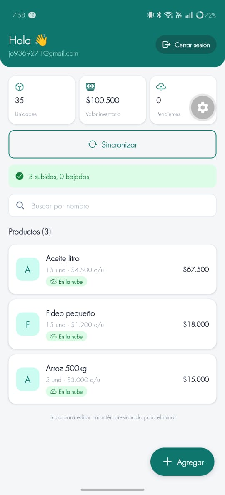
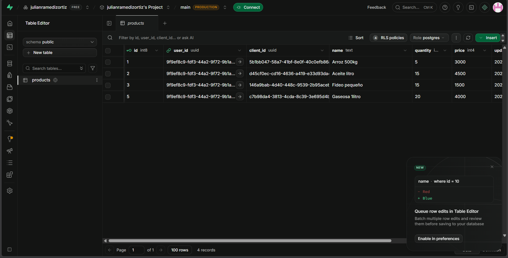

# Mi Tienda — Parcial

App móvil de inventario para la tienda de Doña Rosa (Riohacha). Funciona sin internet (SQLite es la fuente de verdad) y respalda los productos en Supabase al sincronizar.

- **Nombre:** Julián Ramediz Ortiz Ortiz
- **Código:** 0182210071

## Stack

Expo SDK 58 + TypeScript · Expo Router (`Stack.Protected`) · `expo-sqlite` + Drizzle ORM · Supabase (Auth + tabla `products`) · `expo-secure-store` · `expo-crypto`

## Cómo ejecutar

1. Crear `.env` en la raíz (copiar `.env.example`) con los datos del proyecto de Supabase:
   ```
   EXPO_PUBLIC_SUPABASE_URL=https://xxxx.supabase.co
   EXPO_PUBLIC_SUPABASE_PUBLISHABLE_KEY=sb_publishable_xxxx
   ```
2. En Supabase → SQL Editor, ejecutar:
   ```sql
   create table public.products (
     id bigint generated always as identity primary key,
     user_id uuid not null default auth.uid() references auth.users (id) on delete cascade,
     client_id uuid not null unique,
     name text not null,
     quantity integer not null check (quantity >= 0),
     price integer not null check (price >= 0),
     updated_at timestamptz not null,
     created_at timestamptz not null default now()
   );

   alter table public.products enable row level security;

   create policy "ver los míos" on public.products
     for select to authenticated using ((select auth.uid()) = user_id);
   create policy "crear los míos" on public.products
     for insert to authenticated with check ((select auth.uid()) = user_id);
   create policy "editar los míos" on public.products
     for update to authenticated
     using ((select auth.uid()) = user_id)
     with check ((select auth.uid()) = user_id);
   create policy "borrar los míos" on public.products
     for delete to authenticated using ((select auth.uid()) = user_id);
   ```
3. En Supabase → Authentication → Email, desactivar **Confirm email**.
4. Instalar y ejecutar:
   ```bash
   npm install
   npx expo start
   ```

Las migraciones locales están en `drizzle/` y se aplican solas al abrir la app (`useMigrations`). Si se cambia `src/db/schema.ts`: `npx drizzle-kit generate`.

## Estructura

```
src/app/            pantallas (login, registro, index, producto) y _layout con Stack.Protected
src/db/             schema.ts, client.ts, repositories/products.ts
src/hooks/          useProducts.ts (lista en vivo + totales)
src/lib/            supabase.ts, secureStorage.ts (SecureStore por fragmentos)
src/context/        AuthContext.tsx
src/services/       sync.ts (syncProducts: bajar y luego subir)
drizzle/            migraciones generadas
```

## Capturas









## Qué funciona

- Login, registro (correo, contraseña ≥ 6, confirmación) y cerrar sesión con Supabase Auth.
- Sesión persistente en SecureStore (adaptador por fragmentos); rutas protegidas con `Stack.Protected`.
- CRUD local en SQLite con Drizzle; lista reactiva con `useLiveQuery`; funciona en modo avión.
- Totales: unidades, valor del inventario y pendientes por subir.
- Indicador por producto: **en la nube** / **pendiente**.
- Eliminar con confirmación (mantener presionado → `Alert`).
- Sincronizar: baja productos que faltan en el teléfono y sube pendientes con `upsert` por `client_id`; muestra "X subidos, Y bajados" o el error.

### Puntos extra implementados

- **Búsqueda por nombre** en la pantalla principal.
- **"Gana el último cambio"** al bajar: si un producto ya existe en el teléfono pero la versión de la nube tiene `updated_at` más reciente, la nube reemplaza la local. Si la local es más reciente, queda pendiente y se sube.

## Qué faltó

- Puntos extra no implementados: borrado sincronizado (`deletedAt`) y sincronización automática al recuperar conexión.
- _Completar según tus pruebas._
